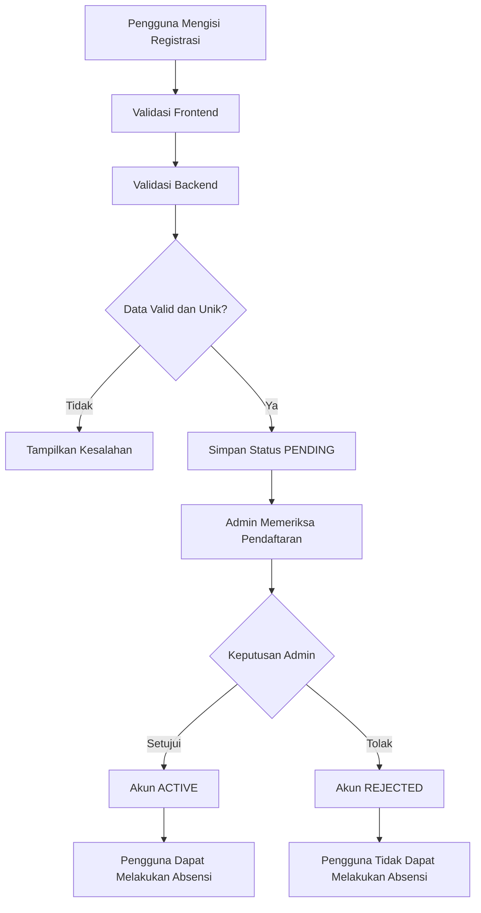
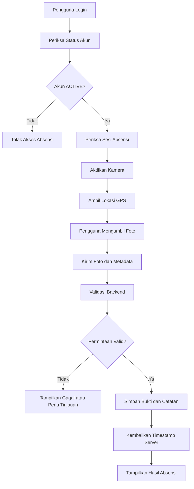

# PRD.md — Sistem Absensi Berbasis Foto, Waktu, dan Lokasi

**Nama Proyek:** Web Attendance System
**Jenis Aplikasi:** Website absensi berbasis foto langsung dari kamera
**Versi Dokumen:** 1.0
**Status:** Draft Spesifikasi Produk
**Platform:** Web responsif (desktop, laptop, tablet, dan smartphone)
**Bahasa Utama:** Bahasa Indonesia
**Zona Waktu Tampilan:** Asia/Jakarta (WIB)
**Target Pengguna:** Mahasiswa, administrator, dan pengelola absensi

---

## 1. Ringkasan Produk

Sistem Absensi Berbasis Foto, Waktu, dan Lokasi adalah aplikasi web yang digunakan untuk mencatat kehadiran pengguna secara digital. Pengguna dapat melakukan absensi setelah akun mereka terdaftar dan disetujui oleh administrator.

Pada saat melakukan absensi, pengguna harus mengambil foto secara langsung melalui kamera perangkat. Sistem kemudian merekam waktu dan tanggal berdasarkan waktu server serta mengambil koordinat lokasi menggunakan GPS atau layanan geolokasi browser.

Sistem ini tidak menggunakan teknologi pengenalan wajah (*face recognition*) maupun pencocokan wajah (*face matching*). Foto yang diambil hanya digunakan sebagai bukti visual kehadiran dan tidak dianalisis untuk mengidentifikasi seseorang secara otomatis.

Sistem juga tidak membatasi lokasi absensi menggunakan geofence. Pengguna dapat melakukan absensi dari lokasi mana pun selama persyaratan absensi terpenuhi. Koordinat lokasi tetap dicatat agar administrator dapat melihat lokasi yang dilaporkan perangkat ketika absensi dilakukan.

### 1.1 Tujuan Produk

1. Mendigitalisasi proses pencatatan kehadiran.
2. Menyediakan bukti kehadiran berupa foto yang diambil melalui kamera langsung.
3. Mencatat waktu dan tanggal absensi berdasarkan waktu server.
4. Mencatat koordinat lokasi, tingkat akurasi, serta waktu pengambilan data lokasi.
5. Mempermudah administrator dalam mengelola akun, memvalidasi pendaftaran, memantau absensi, dan membuat laporan.
6. Menyediakan riwayat absensi yang dapat diakses pengguna sesuai hak aksesnya.
7. Mengurangi pencatatan manual dan kesalahan administrasi.
8. Menyediakan sistem yang aman, responsif, dan dapat dikembangkan lebih lanjut.

### 1.2 Prinsip Utama Sistem

* **Photo-based attendance:** bukti absensi berupa foto langsung dari kamera.
* **No face recognition:** tidak ada pencocokan wajah terhadap database.
* **Server-authoritative timestamp:** waktu resmi absensi berasal dari server.
* **Location recording:** koordinat lokasi direkam sebagai informasi pendukung.
* **No geofence restriction:** lokasi tidak digunakan untuk membatasi area absensi.
* **Admin-controlled registration:** akun baru harus disetujui administrator.
* **Role-based access control:** akses fitur dibedakan berdasarkan peran pengguna.
* **Privacy by design:** foto, lokasi, dan data akun hanya digunakan untuk kebutuhan absensi sesuai kebijakan yang ditetapkan.

---

## 2. Ruang Lingkup Produk

### 2.1 Fitur yang Termasuk dalam Ruang Lingkup

1. Registrasi akun pengguna.
2. Login dan logout.
3. Persetujuan atau penolakan pendaftaran oleh administrator.
4. Pengelolaan profil pengguna.
5. Pengambilan foto melalui kamera langsung.
6. Pengambilan koordinat lokasi perangkat.
7. Pencatatan tanggal dan waktu absensi berdasarkan server.
8. Pencatatan waktu pengambilan foto dan data lokasi dari perangkat sebagai metadata tambahan.
9. Check-in dan check-out.
10. Validasi aturan absensi dan pencegahan duplikasi.
11. Riwayat absensi pengguna.
12. Dashboard administrator.
13. Pengelolaan pengguna.
14. Pengelolaan jadwal dan sesi absensi.
15. Pemantauan data absensi dan bukti foto.
16. Pengelolaan koreksi absensi.
17. Laporan absensi dan ekspor data.
18. Notifikasi status pendaftaran dan hasil koreksi.
19. Audit log untuk aktivitas penting.
20. Pengelolaan keamanan, penyimpanan bukti, dan kebijakan retensi data.

### 2.2 Fitur yang Tidak Termasuk dalam Ruang Lingkup

Fitur berikut tidak menjadi bagian dari versi awal sistem:

* Pengenalan wajah menggunakan AI.
* Pencocokan foto dengan identitas pada database.
* Penyimpanan template biometrik wajah.
* Penentuan identitas berdasarkan wajah.
* Verifikasi liveness berbasis wajah.
* Pelacakan lokasi secara terus-menerus di latar belakang.
* Pembatasan absensi berdasarkan radius lokasi atau geofence.
* Pemantauan perangkat pengguna secara diam-diam.
* Pengambilan foto tanpa tindakan pengguna.
* Absensi otomatis tanpa persetujuan pengguna.
* Integrasi perangkat fingerprint atau mesin absensi khusus.
* Integrasi payroll atau penggajian, kecuali ditambahkan pada versi berikutnya.

**Catatan penting:** pengambilan foto melalui kamera tidak otomatis membuktikan identitas seseorang. Sistem ini mencatat foto yang dikirim oleh akun yang sedang login, bukan memastikan bahwa orang dalam foto adalah pemilik akun tersebut.

---

## 3. Target Pengguna dan Hak Akses

Sistem memiliki dua peran utama: `ADMIN` dan `USER`.

### 3.1 Administrator

Administrator bertanggung jawab mengelola sistem dan data absensi.

Hak akses administrator meliputi:

* Melihat dashboard administrasi.
* Melihat daftar pengguna.
* Melihat detail pendaftaran.
* Menyetujui atau menolak pendaftaran pengguna.
* Mengaktifkan, menonaktifkan, atau menangguhkan akun sesuai kewenangan.
* Melihat dan mengelola profil pengguna.
* Mengelola jadwal dan sesi absensi.
* Melihat seluruh data absensi sesuai kewenangan.
* Melihat bukti foto absensi untuk keperluan administrasi.
* Melihat tanggal, waktu, dan lokasi yang tercatat.
* Menyetujui atau menolak permintaan koreksi absensi.
* Membuat dan mengekspor laporan.
* Melihat audit log.
* Mengelola pengaturan sistem sesuai izin administrator.

Administrator tidak boleh mengubah atau menghapus bukti absensi secara diam-diam. Setiap tindakan administratif yang mengubah data harus dicatat dalam audit log.

### 3.2 Pengguna

Pengguna merupakan orang yang telah mendaftar dan memperoleh persetujuan administrator.

Hak akses pengguna meliputi:

* Melakukan registrasi.
* Melihat status pendaftaran.
* Login dan logout.
* Melihat dashboard pribadi.
* Melihat dan memperbarui data profil yang diizinkan.
* Mengakses kamera untuk mengambil foto absensi.
* Memberikan izin lokasi kepada browser.
* Melakukan check-in dan check-out sesuai aturan.
* Melihat riwayat absensi miliknya sendiri.
* Melihat detail bukti foto, waktu, tanggal, dan lokasi absensi miliknya.
* Mengajukan koreksi absensi.
* Melihat notifikasi dan status permintaan koreksi.

Pengguna tidak boleh melihat atau mengubah data pribadi dan bukti absensi pengguna lain.

### 3.3 Matriks Hak Akses

| Fitur                           | Admin                              | User          |
| ------------------------------- | ---------------------------------- | ------------- |
| Registrasi akun                 | Opsional melalui pengelolaan admin | Ya            |
| Persetujuan pendaftaran         | Ya                                 | Tidak         |
| Login dan logout                | Ya                                 | Ya            |
| Melihat profil sendiri          | Ya                                 | Ya            |
| Mengubah profil sendiri         | Ya                                 | Ya            |
| Melihat semua pengguna          | Ya                                 | Tidak         |
| Melakukan absensi               | Sesuai kebijakan                   | Ya            |
| Melihat riwayat absensi sendiri | Ya                                 | Ya            |
| Melihat semua riwayat absensi   | Ya                                 | Tidak         |
| Mengelola jadwal absensi        | Ya                                 | Tidak         |
| Melihat bukti foto              | Sesuai kewenangan                  | Milik sendiri |
| Mengoreksi absensi              | Menyetujui atau menolak            | Mengajukan    |
| Mengekspor laporan keseluruhan  | Ya                                 | Tidak         |
| Melihat audit log               | Ya                                 | Tidak         |

---

## 4. Teknologi yang Digunakan

### 4.1 Frontend

* **React** sebagai library antarmuka pengguna.
* **TypeScript** untuk penulisan kode yang memiliki tipe data.
* **Vite** sebagai development server dan build tool.
* **Tailwind CSS** untuk styling.
* **shadcn/ui** untuk komponen antarmuka yang konsisten.
* **React Router** untuk navigasi halaman.
* **TanStack Query** untuk pengelolaan data dari API.
* **React Hook Form** untuk pengelolaan formulir.
* **Zod** untuk validasi input.

### 4.2 Backend

* **Node.js** sebagai runtime.
* **NestJS** sebagai framework backend berbasis TypeScript.
* **Prisma ORM** sebagai penghubung aplikasi dengan database.
* **REST API** sebagai mekanisme komunikasi frontend dan backend.
* **Argon2id** untuk hashing kata sandi.
* **Penyimpanan objek privat** yang kompatibel dengan S3 untuk foto absensi, jika tersedia.

### 4.3 Database

* **MySQL 8.4 LTS** sebagai database relasional.

Database menyimpan informasi pengguna, profil, pendaftaran, jadwal, sesi absensi, catatan kehadiran, metadata bukti foto, permintaan koreksi, notifikasi, dan audit log.

File foto disimpan pada penyimpanan objek privat, bukan sebagai string Base64 dalam database. Database menyimpan kunci objek, metadata, dan informasi terkait foto.

### 4.4 API dan Perangkat Browser

Teknologi browser yang digunakan:

* `navigator.mediaDevices.getUserMedia()` untuk meminta akses kamera.
* `HTMLVideoElement` untuk menampilkan pratinjau kamera.
* `HTMLCanvasElement` untuk mengambil frame kamera.
* `navigator.geolocation.getCurrentPosition()` untuk memperoleh koordinat lokasi.
* `fetch()` atau HTTP client yang digunakan aplikasi untuk berkomunikasi dengan API.

Seluruh fitur kamera dan lokasi harus dijalankan melalui koneksi HTTPS pada lingkungan produksi, kecuali konteks pengembangan lokal yang memang diizinkan browser.

### 4.5 Pengujian dan Deployment

* Vitest dan React Testing Library untuk pengujian frontend.
* Jest dan Supertest untuk pengujian backend.
* Playwright untuk pengujian alur aplikasi dari sisi pengguna.
* Docker dan Docker Compose untuk lingkungan pengembangan jika diperlukan.
* CI/CD untuk pengujian dan deployment otomatis jika tersedia.

---

## 5. Alur Utama Sistem

### 5.1 Alur Registrasi Pengguna

1. Pengguna membuka halaman registrasi.
2. Pengguna mengisi data akun dan profil.
3. Frontend memvalidasi format data.
4. Backend memvalidasi ulang seluruh data.
5. Sistem memeriksa keunikan email dan NPM atau identitas pengguna yang digunakan.
6. Sistem menyimpan akun dalam status `PENDING`.
7. Sistem menampilkan informasi bahwa pendaftaran sedang menunggu persetujuan.
8. Administrator membuka daftar pendaftaran.
9. Administrator memeriksa data pendaftaran.
10. Administrator menyetujui atau menolak pendaftaran.
11. Sistem menyimpan keputusan dan mencatat administrator serta waktunya.
12. Jika disetujui, akun berubah menjadi `ACTIVE`.
13. Jika ditolak, akun berubah menjadi `REJECTED` atau tetap tercatat sebagai akun dengan status pendaftaran ditolak.
14. Pengguna menerima notifikasi atau dapat melihat status terbaru saat login.

Akun berstatus `PENDING`, `REJECTED`, atau `SUSPENDED` tidak boleh melakukan absensi.

### 5.2 Alur Login

1. Pengguna memasukkan email dan kata sandi.
2. Backend memvalidasi kredensial.
3. Sistem memeriksa status akun.
4. Jika akun belum disetujui, sistem menampilkan informasi bahwa akun belum aktif.
5. Jika akun ditolak atau ditangguhkan, sistem menolak akses sesuai status.
6. Jika akun aktif dan kredensial benar, sistem membuat sesi autentikasi.
7. Pengguna diarahkan ke dashboard sesuai perannya.

### 5.3 Alur Check-in

1. Pengguna login dan membuka halaman absensi.
2. Frontend meminta izin kamera.
3. Browser menampilkan pratinjau kamera langsung.
4. Pengguna memberikan izin lokasi.
5. Browser mengambil data lokasi dan akurasinya.
6. Frontend menampilkan pratinjau foto yang akan dikirim jika diperlukan.
7. Pengguna menekan tombol **Ambil Foto dan Check-in**.
8. Aplikasi mengambil frame kamera dan mengemasnya sebagai file gambar.
9. Aplikasi mengirim foto, data lokasi, dan metadata pengambilan kepada backend.
10. Backend memvalidasi sesi pengguna, status akun, sesi absensi, aturan jadwal, dan duplikasi.
11. Backend memvalidasi format, ukuran, serta tipe file foto.
12. Backend menentukan waktu resmi berdasarkan jam server.
13. Backend menyimpan foto ke penyimpanan privat.
14. Backend menyimpan catatan check-in dan metadata yang relevan dalam database.
15. Sistem mengembalikan hasil kepada frontend.
16. Frontend menampilkan status berhasil atau gagal berdasarkan respons backend.

**Tidak ada pencocokan wajah dalam proses ini.** Backend tidak membandingkan foto dengan foto profil atau data wajah yang tersimpan.

### 5.4 Alur Check-out

1. Pengguna membuka halaman absensi.
2. Sistem memeriksa apakah pengguna memiliki check-in yang valid pada sesi terkait.
3. Pengguna mengambil foto melalui kamera langsung.
4. Browser memperoleh data lokasi terbaru.
5. Pengguna menekan tombol check-out.
6. Frontend mengirim bukti foto dan data lokasi ke backend.
7. Backend memvalidasi aturan check-out dan mencegah duplikasi.
8. Backend menyimpan waktu resmi, metadata lokasi, dan bukti foto.
9. Frontend menampilkan status check-out berdasarkan hasil backend.

Jika check-in yang diwajibkan tidak ditemukan, sistem menolak check-out atau menerapkan mekanisme pengecualian yang ditetapkan administrator.

### 5.5 Alur Persetujuan Pendaftaran



### 5.6 Alur Absensi



---

## 6. Kebutuhan Fungsional

### FR-001 — Registrasi Akun

Sistem harus menyediakan formulir registrasi pengguna.

Data minimum yang diperlukan:

* Nama lengkap.
* NPM atau nomor identitas pengguna.
* Kelas atau kelompok.
* Nomor telepon.
* Email.
* Kata sandi.
* Konfirmasi kata sandi, jika digunakan.

Persyaratan:

1. Seluruh field wajib harus divalidasi.
2. Format email harus valid.
3. Email harus unik.
4. NPM atau nomor identitas harus unik jika digunakan sebagai identitas utama.
5. Kata sandi harus memenuhi kebijakan keamanan.
6. Kata sandi tidak boleh disimpan dalam bentuk teks biasa.
7. Akun baru harus berstatus `PENDING`.
8. Pengguna tidak dapat mengaktifkan akun sendiri.
9. Pengguna tidak boleh mengirim nilai role `ADMIN` melalui formulir registrasi.
10. Backend harus melakukan validasi meskipun frontend telah memvalidasi data.

### FR-002 — Login dan Logout

Sistem harus menyediakan autentikasi yang aman.

Persyaratan:

* Login menggunakan email dan kata sandi.
* Sistem memeriksa status akun sebelum memberikan akses.
* Pengguna hanya dapat membuka fitur sesuai role.
* Pesan kesalahan login tidak boleh membocorkan informasi sensitif.
* Sistem harus mendukung logout.
* Sesi harus dapat dicabut.
* Sistem perlu menyediakan mekanisme pemulihan kata sandi melalui proses yang aman.
* Endpoint sensitif harus dilindungi dari percobaan login berulang.

### FR-003 — Persetujuan Pendaftaran

Administrator harus dapat:

* Melihat daftar pendaftaran.
* Memfilter pendaftaran berdasarkan status.
* Melihat detail pendaftaran.
* Menyetujui pendaftaran.
* Menolak pendaftaran dengan alasan opsional atau wajib sesuai kebijakan.
* Melihat waktu keputusan.
* Melihat siapa yang mengambil keputusan.

Persetujuan harus dilakukan melalui backend. Mengubah status dari browser atau mengirim permintaan API tanpa kewenangan tidak boleh mengaktifkan akun.

### FR-004 — Pengelolaan Profil

Pengguna dapat melihat dan memperbarui profilnya.

Field profil:

* NPM.
* Nama lengkap.
* Kelas.
* Nomor telepon.
* Email.

Ketentuan:

1. Pengguna hanya dapat memperbarui profil miliknya.
2. Pengguna tidak dapat mengubah role atau status akun.
3. Perubahan email harus melewati verifikasi jika fitur verifikasi email diaktifkan.
4. Perubahan NPM harus divalidasi keunikannya.
5. Perubahan data penting harus dicatat dalam audit log.
6. Administrator dapat mengelola data pengguna sesuai kewenangan.

### FR-005 — Kamera Langsung

Sistem harus menggunakan kamera perangkat untuk mengambil foto absensi.

Persyaratan:

1. Kamera hanya diaktifkan setelah pengguna memberikan izin.
2. Sistem menampilkan pratinjau kamera.
3. Pengguna dapat memilih kamera depan atau belakang jika perangkat dan browser mendukungnya.
4. Sistem mengambil frame dari video kamera saat pengguna menekan tombol pengambilan.
5. Foto dapat ditinjau sebelum dikirim jika kebijakan antarmuka mengizinkan.
6. Foto dikirim sebagai file gambar, bukan sebagai string Base64 berukuran besar.
7. Jika izin kamera ditolak, perangkat tidak memiliki kamera, atau kamera gagal diakses, sistem menampilkan pesan yang sesuai.
8. Pengguna tidak boleh memperoleh status berhasil sebelum backend mengonfirmasi absensi.
9. Pengiriman file gambar dari galeri tidak disediakan sebagai alur absensi normal.
10. Foto tidak dianalisis untuk melakukan pengenalan atau pencocokan wajah.

**Batasan teknis:** penggunaan kamera browser dapat memastikan bahwa aplikasi mengambil frame dari sesi kamera yang dibuka oleh aplikasi. Namun, hal tersebut tidak menjamin secara mutlak bahwa foto tidak dapat dimanipulasi oleh perangkat, browser, atau pengguna yang memiliki kontrol tingkat lanjut.

### FR-006 — Pengambilan Lokasi

Sistem harus meminta izin lokasi browser ketika pengguna melakukan absensi.

Metadata lokasi yang disimpan, jika tersedia:

* Latitude.
* Longitude.
* Accuracy dalam meter.
* Waktu pengambilan lokasi dari perangkat.
* Waktu penerimaan permintaan oleh server.
* Status ketersediaan lokasi.
* Informasi validasi kualitas lokasi.

Ketentuan:

1. Sistem meminta lokasi ketika proses absensi diperlukan, bukan melacak pengguna secara terus-menerus.
2. Sistem harus menampilkan pesan jika izin lokasi ditolak.
3. Sistem harus menangani kondisi lokasi tidak tersedia.
4. Sistem harus memvalidasi rentang koordinat.
5. Sistem harus menyimpan nilai akurasi yang dilaporkan perangkat.
6. Sistem harus membedakan waktu pengambilan lokasi dari waktu penerimaan di server.
7. Sistem tidak boleh menyebut lokasi telah terverifikasi secara independen hanya karena browser mengirim koordinat.
8. Sistem tidak menggunakan geofence untuk membatasi absensi.
9. Koordinat dapat ditampilkan pada peta jika fitur peta diaktifkan.
10. Pengguna harus mengetahui bahwa lokasi dicatat ketika absensi dilakukan.

Lokasi yang diperoleh browser merupakan informasi yang dilaporkan perangkat dan dapat memiliki ketidakakuratan atau manipulasi. Karena itu, lokasi berfungsi sebagai metadata pendukung, bukan bukti mutlak keberadaan fisik pengguna.

### FR-007 — Timestamp dan Tanggal Absensi

Sistem harus mencatat waktu absensi secara konsisten.

Ketentuan:

1. Waktu resmi absensi berasal dari backend.
2. Timestamp dari perangkat tidak boleh menjadi satu-satunya sumber waktu resmi.
3. Database harus menyimpan waktu dengan kebijakan UTC yang konsisten.
4. Tampilan aplikasi menggunakan zona waktu `Asia/Jakarta` secara default.
5. Sistem mencatat waktu check-in dan check-out secara terpisah.
6. Sistem dapat menyimpan waktu pengambilan foto dari perangkat sebagai metadata tambahan.
7. Sistem dapat menyimpan waktu pengambilan lokasi dari perangkat sebagai metadata tambahan.
8. Sistem menyimpan waktu ketika backend menerima permintaan.
9. Jika waktu perangkat berbeda dari waktu server, waktu server tetap digunakan untuk catatan resmi.
10. Semua tampilan riwayat harus menggunakan aturan konversi zona waktu yang konsisten.

Field waktu minimum pada catatan absensi:

* `serverTimestamp`: waktu resmi absensi.
* `receivedAt`: waktu backend menerima permintaan, jika dipisahkan dari waktu pembuatan catatan.
* `photoCapturedAtClient`: waktu pengambilan foto yang dilaporkan perangkat, jika tersedia.
* `locationCapturedAtClient`: waktu pengambilan lokasi yang dilaporkan perangkat, jika tersedia.

Waktu perangkat harus dianggap sebagai metadata yang tidak sepenuhnya tepercaya.

### FR-008 — Check-in dan Check-out

Sistem harus mendukung dua jenis absensi:

* `CHECK_IN`
* `CHECK_OUT`

Ketentuan:

1. Check-in dan check-out harus dibedakan dengan jelas.
2. Sistem harus mengetahui sesi atau jadwal absensi yang sedang berlaku.
3. Pengguna tidak boleh melakukan check-in berulang untuk kombinasi sesi dan jenis absensi yang sama.
4. Pengguna tidak boleh melakukan check-out berulang untuk kombinasi sesi dan jenis absensi yang sama.
5. Check-out harus mengikuti aturan check-in yang berlaku.
6. Setiap catatan absensi harus terhubung ke pengguna yang terautentikasi.
7. Pengguna tidak boleh memilih `userId` milik orang lain melalui request.
8. Jika terjadi pengiriman berulang akibat koneksi internet, sistem tidak boleh membuat catatan duplikat.
9. Sistem harus memiliki aturan yang jelas untuk absensi terlambat.
10. Pengecualian harus dilakukan melalui mekanisme administrasi yang tercatat.

### FR-009 — Jadwal dan Sesi Absensi

Administrator harus dapat mengatur sesi absensi.

Data sesi dapat mencakup:

* Nama sesi.
* Tanggal pelaksanaan.
* Waktu mulai check-in.
* Batas waktu check-in.
* Waktu mulai check-out.
* Batas waktu check-out.
* Kelas atau kelompok yang ditargetkan.
* Status sesi.
* Aturan keterlambatan.
* Catatan sesi.

Sesi dapat memiliki status:

* `DRAFT`
* `PUBLISHED`
* `ACTIVE`
* `CLOSED`
* `CANCELLED`

Sistem harus memvalidasi sesi yang berlaku sebelum menerima absensi. Sesi yang telah ditutup atau dibatalkan tidak dapat menerima absensi baru kecuali melalui prosedur pengecualian yang sah.

Jika organisasi memilih absensi fleksibel tanpa jadwal, aturan tersebut harus dikonfigurasi secara eksplisit, bukan dianggap sebagai perilaku default yang tidak terdokumentasi.

### FR-010 — Riwayat Absensi Pengguna

Pengguna harus dapat melihat riwayat absensi miliknya.

Informasi yang ditampilkan:

* Tanggal.
* Jenis absensi.
* Waktu resmi.
* Status kehadiran.
* Nama sesi.
* Foto bukti.
* Koordinat atau informasi lokasi.
* Akurasi lokasi.
* Status koreksi, jika ada.

Fitur riwayat harus menyediakan:

* Filter berdasarkan tanggal.
* Filter berdasarkan jenis absensi.
* Filter berdasarkan status.
* Tampilan detail catatan.
* Pagination untuk data yang banyak.

Pengguna tidak boleh mengakses riwayat milik orang lain dengan memodifikasi ID pada URL atau API.

### FR-011 — Dashboard Administrator

Dashboard administrator harus menyajikan ringkasan data yang relevan.

Informasi yang dapat ditampilkan:

* Jumlah seluruh pengguna.
* Jumlah akun aktif.
* Jumlah pendaftaran yang menunggu persetujuan.
* Jumlah absensi hari ini.
* Jumlah pengguna yang sudah check-in.
* Jumlah pengguna yang sudah check-out.
* Jumlah keterlambatan.
* Jumlah absensi yang memerlukan peninjauan.
* Aktivitas administrasi terbaru.

Angka pada dashboard harus berasal dari data backend. Dashboard tidak boleh hanya menghitung data yang kebetulan sudah dimuat pada frontend.

### FR-012 — Manajemen Absensi oleh Administrator

Administrator harus dapat:

* Melihat seluruh catatan absensi yang berada dalam kewenangannya.
* Memfilter berdasarkan nama, NPM, kelas, sesi, tanggal, dan status.
* Membuka detail absensi.
* Melihat bukti foto melalui akses yang terkontrol.
* Melihat timestamp resmi.
* Melihat metadata lokasi.
* Menandai catatan untuk peninjauan.
* Memproses permintaan koreksi.
* Mencatat alasan perubahan atau keputusan.

Jika administrator mengoreksi data absensi, sistem harus mempertahankan jejak perubahan. Bukti asli dan data sebelumnya tidak boleh dihapus tanpa jejak audit sesuai kebijakan retensi.

### FR-013 — Koreksi Absensi

Pengguna dapat mengajukan koreksi jika mengalami masalah, seperti:

* Gagal mengambil foto.
* Check-in tercatat tidak lengkap.
* Check-out tidak berhasil.
* Gangguan koneksi ketika absensi dilakukan.
* Kesalahan administratif lain yang dapat dijelaskan.

Data permintaan koreksi:

* Pengguna.
* Catatan absensi terkait, jika ada.
* Jenis koreksi.
* Alasan.
* Waktu pengajuan.
* Lampiran pendukung jika diizinkan.
* Status.
* Keputusan administrator.
* Alasan keputusan.
* Waktu penyelesaian.

Status koreksi:

* `PENDING`
* `APPROVED`
* `REJECTED`
* `CANCELLED`

Persetujuan koreksi tidak boleh secara otomatis mengubah timestamp asli tanpa menyimpan nilai awal dan alasan perubahan.

### FR-014 — Laporan dan Ekspor

Administrator dapat membuat laporan berdasarkan:

* Rentang tanggal.
* Pengguna.
* NPM.
* Kelas.
* Sesi.
* Jenis absensi.
* Status kehadiran.
* Status keterlambatan.

Format ekspor minimum:

* CSV.

Format tambahan yang dapat disediakan:

* XLSX.
* PDF.

Laporan harus mencantumkan zona waktu yang digunakan dan membedakan timestamp resmi dengan metadata waktu perangkat jika keduanya ditampilkan.

Ekspor data harus dibatasi berdasarkan hak akses dan tidak boleh menyertakan foto atau koordinat yang tidak diperlukan dalam laporan.

### FR-015 — Notifikasi

Sistem harus menyediakan notifikasi untuk kejadian penting.

Notifikasi minimum:

* Pendaftaran berhasil dikirim.
* Pendaftaran disetujui.
* Pendaftaran ditolak.
* Koreksi absensi diajukan.
* Koreksi absensi disetujui.
* Koreksi absensi ditolak.
* Perubahan status akun.

Notifikasi dapat ditampilkan di dalam aplikasi. Email dapat ditambahkan sebagai fitur opsional.

### FR-016 — Audit Log

Sistem harus mencatat aktivitas sensitif, termasuk:

* Persetujuan atau penolakan pendaftaran.
* Perubahan status akun.
* Perubahan data profil penting.
* Pembuatan dan perubahan jadwal.
* Koreksi absensi.
* Ekspor laporan.
* Penghapusan atau penjadwalan penghapusan bukti.
* Tindakan administratif lain yang berpengaruh pada data.

Informasi audit log:

* Aktor.
* Jenis tindakan.
* Entitas yang terpengaruh.
* Waktu tindakan dari server.
* Ringkasan perubahan.
* Alasan, jika diperlukan.
* Informasi request yang relevan tanpa menyimpan rahasia autentikasi.

Audit log harus memiliki pembatasan akses dan tidak dapat diubah oleh pengguna biasa.

---

## 7. Kebutuhan Nonfungsional

### NFR-001 — Keamanan

Sistem harus:

* Menggunakan HTTPS pada produksi.
* Menyimpan kata sandi menggunakan hashing yang kuat, seperti Argon2id.
* Menggunakan autentikasi dan otorisasi backend.
* Melindungi endpoint dengan role guard dan pemeriksaan kepemilikan data.
* Memvalidasi semua input pada backend.
* Membatasi ukuran dan tipe file foto.
* Menyimpan foto dalam penyimpanan privat.
* Tidak menaruh kunci penyimpanan atau rahasia server di frontend.
* Menerapkan rate limiting pada endpoint sensitif.
* Menggunakan pengelolaan sesi yang aman.
* Mencegah akses langsung tanpa otorisasi ke foto absensi.
* Melindungi endpoint ekspor dan administrasi.
* Mencatat aktivitas penting melalui audit log.

Jika autentikasi menggunakan cookie, cookie harus memiliki pengaturan yang sesuai seperti `HttpOnly`, `Secure`, dan `SameSite`, serta perlindungan CSRF yang relevan. Jika menggunakan token, mekanisme penyimpanan dan rotasi token harus dirancang dengan aman.

### NFR-002 — Privasi Data

Data yang dikelola meliputi:

* Identitas pengguna.
* Informasi kontak.
* Foto absensi.
* Koordinat lokasi.
* Metadata waktu.
* Riwayat kehadiran.

Sistem harus menerapkan prinsip minimisasi data. Data hanya dikumpulkan jika dibutuhkan untuk fungsi absensi dan administrasi.

Ketentuan:

1. Pengguna harus diberi informasi tentang pengumpulan foto dan lokasi.
2. Akses terhadap foto dan koordinat harus dibatasi.
3. Foto tidak boleh dipublikasikan melalui URL publik permanen.
4. Sistem tidak menggunakan foto untuk pencocokan wajah.
5. Sistem tidak membuat template biometrik wajah.
6. Data tidak boleh digunakan untuk tujuan lain tanpa dasar dan pemberitahuan yang sesuai.
7. Retensi dan penghapusan data harus mengikuti kebijakan organisasi serta kewajiban hukum yang berlaku.
8. Akses administratif terhadap data pribadi harus dibatasi dan dapat diaudit.

### NFR-003 — Performa

Target awal yang dapat digunakan untuk pengujian:

* API umum memiliki waktu respons p95 di bawah 500 ms pada kondisi uji yang ditetapkan.
* Pengiriman foto diproses tanpa memblokir antarmuka secara tidak perlu.
* Halaman utama dapat ditampilkan dengan cepat pada koneksi yang wajar.
* Daftar pengguna dan riwayat menggunakan pagination.
* Laporan berukuran besar diproses secara efisien.
* Foto dioptimalkan sesuai kebutuhan tanpa mengurangi keterbacaan bukti secara berlebihan.

Waktu unggah foto dipengaruhi ukuran gambar, jaringan pengguna, dan lokasi server. Karena itu, waktu penyelesaian absensi secara keseluruhan tidak dapat dijamin sama untuk semua perangkat.

### NFR-004 — Ketersediaan dan Ketahanan

Sistem harus:

* Menangani koneksi terputus.
* Menampilkan status pemrosesan saat foto diunggah.
* Mencegah duplikasi saat pengguna mengulangi request.
* Menyimpan catatan absensi secara konsisten.
* Memiliki backup database.
* Memiliki kebijakan backup bukti foto.
* Mencatat error server.
* Menyediakan mekanisme pemulihan jika penyimpanan foto gagal.

Jika foto gagal disimpan, sistem tidak boleh menyatakan absensi berhasil apabila foto merupakan persyaratan wajib.

### NFR-005 — Kompatibilitas

Antarmuka harus mendukung browser modern pada:

* Windows.
* macOS.
* Android.
* iOS.

Akses kamera dan lokasi harus diuji pada perangkat nyata. Dukungan dapat berbeda berdasarkan browser, izin, konfigurasi sistem operasi, dan ketersediaan perangkat keras.

### NFR-006 — Aksesibilitas dan Usability

Sistem harus:

* Memiliki tampilan responsif.
* Menggunakan label formulir yang jelas.
* Menyediakan pesan validasi yang mudah dipahami.
* Memiliki indikator loading.
* Menampilkan status sukses dan gagal secara jelas.
* Memiliki tombol dengan ukuran yang nyaman pada perangkat seluler.
* Tidak bergantung hanya pada warna untuk menyampaikan status.
* Menyediakan konfirmasi sebelum tindakan administratif yang penting.

---

## 8. Aturan Bisnis

| ID     | Aturan                                                                                     |
| ------ | ------------------------------------------------------------------------------------------ |
| BR-001 | Setiap pengguna harus memiliki akun yang valid.                                            |
| BR-002 | Akun baru berstatus `PENDING`.                                                             |
| BR-003 | Hanya akun `ACTIVE` yang dapat melakukan absensi.                                          |
| BR-004 | Akun `REJECTED` dan `SUSPENDED` tidak dapat melakukan absensi.                             |
| BR-005 | Setiap absensi normal harus memiliki bukti foto yang berhasil disimpan.                    |
| BR-006 | Foto diambil melalui kamera langsung dalam alur absensi normal.                            |
| BR-007 | Sistem tidak mencocokkan wajah dengan database.                                            |
| BR-008 | Timestamp resmi berasal dari server.                                                       |
| BR-009 | Timestamp perangkat hanya menjadi metadata tambahan.                                       |
| BR-010 | Lokasi dicatat jika data lokasi tersedia dan memenuhi kebijakan kualitas yang ditetapkan.  |
| BR-011 | Tidak ada pembatasan lokasi menggunakan geofence.                                          |
| BR-012 | Satu pengguna tidak boleh membuat catatan duplikat untuk jenis absensi dan sesi yang sama. |
| BR-013 | Check-out mengikuti aturan check-in dan sesi yang berlaku.                                 |
| BR-014 | Pengguna hanya dapat melihat data absensinya sendiri.                                      |
| BR-015 | Administrator hanya dapat melakukan tindakan sesuai kewenangannya.                         |
| BR-016 | Koreksi absensi harus memiliki alasan dan jejak audit.                                     |
| BR-017 | Penghapusan bukti harus mengikuti kebijakan retensi dan tercatat.                          |
| BR-018 | Status berhasil hanya ditampilkan setelah backend mengonfirmasi transaksi.                 |
| BR-019 | Kegagalan penyimpanan bukti tidak boleh menghasilkan absensi sukses palsu.                 |
| BR-020 | Kegagalan memperoleh lokasi harus ditangani sesuai kebijakan yang ditentukan organisasi.   |

### 8.1 Kebijakan Lokasi

Karena absensi tidak dibatasi geofence, koordinat tidak digunakan untuk menolak absensi hanya karena pengguna berada jauh dari kampus, kantor, atau lokasi tertentu.

Namun, organisasi harus memilih salah satu kebijakan ketika lokasi tidak tersedia:

1. **Wajib tersedia:** absensi ditolak jika lokasi tidak dapat diperoleh.
2. **Boleh tanpa lokasi:** absensi dapat disimpan dengan status lokasi `UNAVAILABLE`.
3. **Perlu peninjauan:** absensi disimpan sebagai catatan yang memerlukan pemeriksaan administrator.

Kebijakan tersebut harus dikonfigurasi secara eksplisit. Ketiadaan data lokasi tidak boleh ditampilkan sebagai lokasi yang berhasil diverifikasi.

### 8.2 Kebijakan Akurasi Lokasi

Sistem menyimpan nilai akurasi yang dilaporkan perangkat. Organisasi dapat menetapkan ambang akurasi, misalnya 100 meter, sebagai aturan operasional.

Nilai tersebut merupakan contoh konfigurasi, bukan jaminan bahwa koordinat benar. Jika akurasi berada di luar batas, sistem dapat memberi peringatan, menandai catatan, atau menerapkan kebijakan peninjauan.

### 8.3 Kebijakan Keterlambatan

Sistem harus mendukung konfigurasi berikut:

* Absensi tetap diterima dan diberi status `LATE`.
* Absensi diterima tetapi memerlukan peninjauan.
* Absensi ditolak setelah batas waktu tertentu.

Pilihan kebijakan harus ditentukan administrator atau pemilik produk sebelum penerapan produksi.

---

## 9. Status dan Model Data

### 9.1 Status Akun

* `PENDING`
* `ACTIVE`
* `REJECTED`
* `SUSPENDED`

### 9.2 Status Pendaftaran

* `PENDING`
* `APPROVED`
* `REJECTED`
* `CANCELLED`

Status akun dan status permohonan pendaftaran sebaiknya dipisahkan agar riwayat keputusan tetap tersimpan walaupun status akun berubah di kemudian hari.

### 9.3 Status Absensi

Status yang disarankan:

* `PRESENT`
* `LATE`
* `NEEDS_REVIEW`
* `REJECTED`

Status ini merepresentasikan hasil administrasi absensi, bukan hasil pencocokan wajah.

### 9.4 Status Lokasi

* `AVAILABLE`
* `UNAVAILABLE`
* `LOW_ACCURACY`
* `INVALID`

### 9.5 Status Bukti Foto

* `PENDING_UPLOAD`
* `STORED`
* `FAILED`
* `QUARANTINED`
* `DELETED`

### 9.6 Status Koreksi

* `PENDING`
* `APPROVED`
* `REJECTED`
* `CANCELLED`

---

## 10. Rancangan Entitas Database

Rancangan berikut merupakan model konseptual. Nama field dan tipe data akhir harus disesuaikan dengan implementasi Prisma dan MySQL.

### 10.1 User

Menyimpan data autentikasi dan status akun.

Field utama:

* `id`
* `email`
* `passwordHash`
* `role`
* `accountStatus`
* `emailVerifiedAt`
* `lastLoginAt`
* `createdAt`
* `updatedAt`

Ketentuan:

* Email harus unik.
* Role ditentukan melalui mekanisme yang berwenang.
* Password hanya disimpan dalam bentuk hash.
* Status akun diperiksa sebelum mengizinkan absensi.

### 10.2 UserProfile

Menyimpan informasi profil pengguna.

Field utama:

* `id`
* `userId`
* `npm`
* `fullName`
* `className`
* `phoneNumber`
* `createdAt`
* `updatedAt`

Ketentuan:

* `userId` terhubung ke `User`.
* NPM harus unik jika digunakan sebagai identitas pengguna.
* Pengguna hanya dapat memperbarui profil miliknya sendiri.

### 10.3 RegistrationRequest

Menyimpan riwayat permohonan pendaftaran.

Field utama:

* `id`
* `userId`
* `status`
* `submittedAt`
* `reviewedAt`
* `reviewedBy`
* `rejectionReason`
* `createdAt`
* `updatedAt`

Sistem harus mencegah beberapa permohonan berstatus `PENDING` untuk akun yang sama, kecuali alur pendaftaran ulang memang dirancang untuk mengizinkannya.

### 10.4 Schedule

Menyimpan konfigurasi jadwal.

Field utama:

* `id`
* `name`
* `description`
* `checkInStartAt`
* `checkInEndAt`
* `checkOutStartAt`
* `checkOutEndAt`
* `lateAfter`
* `status`
* `createdBy`
* `createdAt`
* `updatedAt`

Jika jadwal berulang, struktur pengulangan dan zona waktu harus dirancang secara eksplisit.

### 10.5 AttendanceSession

Merepresentasikan sesi absensi pada tanggal tertentu.

Field utama:

* `id`
* `scheduleId`
* `sessionDate`
* `status`
* `createdAt`
* `updatedAt`

Sistem harus mencegah sesi ganda untuk jadwal dan tanggal yang sama jika aturan produk mengharuskannya.

### 10.6 AttendanceRecord

Menyimpan catatan absensi.

Field utama:

* `id`
* `userId`
* `sessionId`
* `type`
* `status`
* `serverTimestamp`
* `receivedAt`
* `photoEvidenceId`
* `latitude`
* `longitude`
* `accuracyMeters`
* `locationStatus`
* `locationCapturedAtClient`
* `photoCapturedAtClient`
* `idempotencyKey`
* `createdAt`
* `updatedAt`

Ketentuan:

* `userId` diambil dari identitas pengguna yang telah diautentikasi.
* `serverTimestamp` menjadi waktu resmi.
* Metadata waktu perangkat tidak dianggap sebagai sumber waktu resmi.
* Latitude dan longitude harus memiliki rentang nilai yang valid.
* Sistem harus mencegah duplikasi.
* Catatan harus terhubung ke bukti foto yang sesuai jika foto diwajibkan.

### 10.7 AttendanceEvidence

Menyimpan metadata file bukti.

Field utama:

* `id`
* `attendanceRecordId`
* `objectKey`
* `mimeType`
* `fileSizeBytes`
* `sha256`
* `uploadedAt`
* `capturedAtClient`
* `status`
* `expiresAt`
* `createdAt`

File fisik disimpan dalam penyimpanan privat. Field `objectKey` merupakan referensi internal dan tidak boleh langsung digunakan sebagai URL publik.

### 10.8 AttendanceCorrection

Menyimpan permintaan koreksi.

Field utama:

* `id`
* `attendanceRecordId`
* `userId`
* `reason`
* `status`
* `reviewedBy`
* `reviewedAt`
* `reviewNote`
* `createdAt`
* `updatedAt`

### 10.9 Notification

Menyimpan notifikasi aplikasi.

Field utama:

* `id`
* `userId`
* `type`
* `title`
* `message`
* `readAt`
* `createdAt`

### 10.10 AuditLog

Menyimpan catatan tindakan sensitif.

Field utama:

* `id`
* `actorUserId`
* `action`
* `entityType`
* `entityId`
* `beforeData`
* `afterData`
* `reason`
* `createdAt`

Data audit tidak boleh menyimpan kata sandi, token sesi, atau rahasia lain.

### 10.11 AuthSession

Menyimpan informasi sesi autentikasi jika pendekatan autentikasi yang dipilih memerlukannya.

Field utama:

* `id`
* `userId`
* `sessionTokenHash`
* `expiresAt`
* `revokedAt`
* `createdAt`

Penyimpanan sesi harus mengikuti mekanisme autentikasi yang dipilih dan tidak boleh menyimpan token sensitif dalam bentuk yang tidak aman.

### 10.12 Hubungan Antartabel

Hubungan inti:

* Satu `User` memiliki satu `UserProfile`.
* Satu `User` dapat memiliki banyak `RegistrationRequest`.
* Satu `Schedule` dapat memiliki banyak `AttendanceSession`.
* Satu `AttendanceSession` memiliki banyak `AttendanceRecord`.
* Satu `User` dapat memiliki banyak `AttendanceRecord`.
* Satu `AttendanceRecord` memiliki bukti foto sesuai kebijakan absensi.
* Satu `AttendanceRecord` dapat memiliki beberapa permintaan koreksi sepanjang riwayat koreksi diizinkan.
* Satu `User` dapat memiliki banyak `Notification`.
* Satu `User` dapat menghasilkan banyak `AuditLog` sebagai aktor.
* Satu `User` dapat memiliki beberapa sesi autentikasi.

**Tidak ada tabel `FaceProfile`, `FaceEmbedding`, atau `FaceTemplate`**, karena sistem tidak melakukan pencocokan wajah dan tidak membutuhkan penyimpanan data biometrik wajah.

---

## 11. Rancangan REST API

Semua endpoint menggunakan prefix:

`/api/v1`

Endpoint harus menerapkan autentikasi, otorisasi, validasi input, dan pembatasan akses yang sesuai.

### 11.1 Authentication

| Method | Endpoint                | Fungsi                                      |
| ------ | ----------------------- | ------------------------------------------- |
| POST   | `/auth/register`        | Membuat pendaftaran akun                    |
| POST   | `/auth/login`           | Login                                       |
| POST   | `/auth/logout`          | Logout                                      |
| POST   | `/auth/refresh`         | Memperbarui sesi/token jika digunakan       |
| POST   | `/auth/forgot-password` | Meminta pemulihan kata sandi                |
| POST   | `/auth/reset-password`  | Mengatur ulang kata sandi                   |
| GET    | `/auth/me`              | Mendapatkan data pengguna yang sedang login |

### 11.2 Registrasi dan Persetujuan

| Method | Endpoint                           | Fungsi                             |
| ------ | ---------------------------------- | ---------------------------------- |
| GET    | `/registrations/me`                | Melihat status pendaftaran sendiri |
| GET    | `/admin/registrations`             | Melihat daftar pendaftaran         |
| GET    | `/admin/registrations/:id`         | Melihat detail pendaftaran         |
| POST   | `/admin/registrations/:id/approve` | Menyetujui pendaftaran             |
| POST   | `/admin/registrations/:id/reject`  | Menolak pendaftaran                |

Endpoint admin hanya boleh diakses oleh administrator yang berwenang.

### 11.3 Profil dan Pengguna

| Method | Endpoint                  | Fungsi                                 |
| ------ | ------------------------- | -------------------------------------- |
| GET    | `/users/me`               | Melihat profil sendiri                 |
| PATCH  | `/users/me`               | Memperbarui profil sendiri             |
| GET    | `/admin/users`            | Melihat daftar pengguna                |
| GET    | `/admin/users/:id`        | Melihat detail pengguna                |
| PATCH  | `/admin/users/:id/status` | Mengubah status akun sesuai kewenangan |

### 11.4 Jadwal dan Sesi

| Method | Endpoint                       | Fungsi                      |
| ------ | ------------------------------ | --------------------------- |
| GET    | `/schedules`                   | Melihat jadwal yang relevan |
| GET    | `/schedules/:id`               | Melihat detail jadwal       |
| POST   | `/admin/schedules`             | Membuat jadwal              |
| PATCH  | `/admin/schedules/:id`         | Memperbarui jadwal          |
| POST   | `/admin/schedules/:id/publish` | Mempublikasikan jadwal      |
| POST   | `/admin/schedules/:id/close`   | Menutup jadwal              |
| GET    | `/attendance-sessions`         | Melihat sesi yang tersedia  |

### 11.5 Absensi

| Method | Endpoint                     | Fungsi                                  |
| ------ | ---------------------------- | --------------------------------------- |
| GET    | `/attendance/precheck`       | Memeriksa kesiapan absensi              |
| POST   | `/attendance/check-in`       | Melakukan check-in                      |
| POST   | `/attendance/check-out`      | Melakukan check-out                     |
| GET    | `/attendance/me`             | Melihat riwayat sendiri                 |
| GET    | `/attendance/me/:id`         | Melihat detail absensi sendiri          |
| GET    | `/admin/attendance`          | Melihat semua absensi sesuai kewenangan |
| GET    | `/admin/attendance/:id`      | Melihat detail absensi                  |
| POST   | `/admin/attendance/:id/flag` | Menandai catatan untuk peninjauan       |

### 11.6 Koreksi Absensi

| Method | Endpoint                                    | Fungsi                             |
| ------ | ------------------------------------------- | ---------------------------------- |
| POST   | `/attendance/:id/corrections`               | Mengajukan koreksi                 |
| GET    | `/attendance/corrections/me`                | Melihat permintaan koreksi sendiri |
| GET    | `/admin/attendance-corrections`             | Melihat semua permintaan koreksi   |
| POST   | `/admin/attendance-corrections/:id/approve` | Menyetujui koreksi                 |
| POST   | `/admin/attendance-corrections/:id/reject`  | Menolak koreksi                    |

### 11.7 Laporan

| Method | Endpoint                           | Fungsi                    |
| ------ | ---------------------------------- | ------------------------- |
| GET    | `/admin/reports/attendance`        | Mengambil laporan absensi |
| GET    | `/admin/reports/attendance/export` | Mengekspor laporan        |
| GET    | `/admin/audit-logs`                | Melihat audit log         |

### 11.8 Contoh Request Check-in

Request menggunakan `multipart/form-data`.

Header:

* `Authorization` atau mekanisme sesi yang dipilih.
* `Idempotency-Key` dengan nilai unik untuk satu tindakan absensi.

Field:

* `evidence`: file foto yang diambil melalui kamera.
* `sessionId`: sesi absensi.
* `latitude`: koordinat lintang.
* `longitude`: koordinat bujur.
* `accuracyMeters`: akurasi lokasi.
* `locationCapturedAtClient`: waktu pengambilan lokasi yang dilaporkan perangkat.
* `photoCapturedAtClient`: waktu pengambilan foto yang dilaporkan perangkat, jika tersedia.

Backend menentukan pengguna berdasarkan sesi autentikasi, bukan dari `userId` yang dikirim frontend.

### 11.9 Contoh Response Berhasil

```json
{
  "success": true,
  "data": {
    "id": "attendance-record-id",
    "type": "CHECK_IN",
    "status": "PRESENT",
    "serverTimestamp": "2026-10-10T03:00:00.000Z",
    "displayTimezone": "Asia/Jakarta",
    "location": {
      "latitude": -6.2,
      "longitude": 106.8,
      "accuracyMeters": 25,
      "status": "AVAILABLE"
    },
    "evidence": {
      "status": "STORED"
    }
  }
}
```

Contoh tersebut menggunakan data ilustratif, bukan hasil absensi aktual.

### 11.10 Contoh Response Gagal

```json
{
  "success": false,
  "error": {
    "code": "ATTENDANCE_SESSION_CLOSED",
    "message": "Sesi absensi sudah ditutup."
  }
}
```

Kode error harus konsisten agar frontend dapat menampilkan pesan yang tepat.

---

## 12. Rancangan Antarmuka Pengguna

### 12.1 Halaman Publik

* Login.
* Registrasi.
* Lupa kata sandi.
* Informasi status pendaftaran.

### 12.2 Halaman Pengguna

**Dashboard pengguna**

Menampilkan:

* Sapaan dan nama pengguna.
* Status akun.
* Jadwal atau sesi absensi yang tersedia.
* Status check-in dan check-out.
* Ringkasan kehadiran.
* Riwayat terbaru.
* Notifikasi.

**Halaman absensi**

Menampilkan:

* Jenis absensi.
* Sesi yang dipilih.
* Jam perangkat sebagai informasi visual, jika ditampilkan.
* Status koneksi kamera.
* Pratinjau kamera.
* Status izin lokasi.
* Koordinat dan akurasi lokasi jika tersedia.
* Tombol pengambilan foto.
* Tombol konfirmasi absensi.
* Indikator proses unggah.
* Hasil absensi berdasarkan respons server.

**Halaman riwayat**

Menampilkan:

* Daftar absensi.
* Tanggal dan waktu resmi.
* Jenis absensi.
* Status.
* Detail foto dan lokasi.
* Filter tanggal dan status.

**Halaman profil**

Menampilkan data identitas dan kontak yang diizinkan untuk diperbarui.

**Halaman koreksi**

Menampilkan formulir pengajuan koreksi dan status pengajuannya.

### 12.3 Halaman Administrator

**Dashboard admin**

Menampilkan ringkasan pengguna, pendaftaran, dan absensi.

**Manajemen pendaftaran**

Menampilkan daftar permohonan, detail data, serta tombol persetujuan atau penolakan.

**Manajemen pengguna**

Menampilkan daftar pengguna dengan pencarian, filter, dan detail profil.

**Manajemen jadwal**

Menampilkan pembuatan, pengubahan, publikasi, dan penutupan sesi absensi.

**Manajemen absensi**

Menampilkan tabel absensi dengan filter, detail foto, metadata lokasi, serta status kehadiran.

**Manajemen koreksi**

Menampilkan permintaan koreksi beserta alasan dan riwayat keputusan.

**Laporan**

Menyediakan filter periode dan ekspor data.

**Audit log**

Menampilkan aktivitas penting yang dilakukan administrator dan pengguna.

### 12.4 Prinsip Desain Antarmuka

* Tampilan bersih dan profesional.
* Navigasi konsisten.
* Formulir mudah dipahami.
* Antarmuka responsif untuk HP dan desktop.
* Status proses kamera dan lokasi terlihat jelas.
* Pengguna tidak dibuat mengira absensi berhasil sebelum server mengonfirmasinya.
* Data lokasi tidak ditampilkan kepada pihak yang tidak memiliki hak akses.
* Tidak menyediakan komponen UI untuk face matching atau face enrollment.

---

## 13. Penanganan Error dan Kondisi Khusus

### 13.1 Kamera Tidak Dapat Diakses

Kemungkinan penyebab:

* Pengguna menolak izin kamera.
* Kamera tidak tersedia.
* Kamera sedang digunakan aplikasi lain.
* Browser tidak mendukung fitur yang diperlukan.
* Halaman tidak berjalan dalam konteks aman.

Perilaku sistem:

1. Menampilkan pesan yang menjelaskan masalah.
2. Menyediakan tombol untuk mencoba kembali.
3. Memberikan petunjuk memeriksa izin browser.
4. Tidak membuat catatan absensi sukses tanpa bukti yang diwajibkan.

### 13.2 Lokasi Tidak Tersedia

Kemungkinan penyebab:

* Pengguna menolak izin lokasi.
* GPS tidak aktif.
* Perangkat gagal menentukan lokasi.
* Koneksi atau layanan lokasi bermasalah.
* Waktu permintaan lokasi habis.

Perilaku sistem mengikuti kebijakan lokasi organisasi. Sistem harus menampilkan kondisi sebenarnya dan tidak mengarang koordinat.

### 13.3 Koneksi Internet Terputus

* Sistem menampilkan status koneksi.
* Pengguna dapat mencoba kembali.
* Request yang sama harus menggunakan mekanisme idempotensi.
* Sistem memeriksa apakah request sebelumnya sudah berhasil sebelum membuat catatan baru.
* Sistem tidak boleh membuat duplikasi ketika pengguna mengulangi pengiriman.

### 13.4 Upload Foto Gagal

* Sistem tidak menampilkan keberhasilan.
* Backend membersihkan objek sementara yang tidak terpakai sesuai kebijakan.
* Pengguna mendapat pesan untuk mencoba kembali.
* Error dicatat tanpa menyimpan informasi rahasia.

### 13.5 Akun Tidak Aktif

Jika akun bukan `ACTIVE`, sistem menolak absensi dan menampilkan pesan sesuai status akun.

### 13.6 Absensi Duplikat

Jika pengguna telah melakukan jenis absensi yang sama pada sesi yang sama:

* Sistem menolak catatan baru atau mengembalikan hasil catatan yang sudah ada sesuai desain API.
* Tidak boleh membuat catatan kedua.
* Hasil harus tetap konsisten ketika terjadi request bersamaan.

### 13.7 Foto Tidak Dapat Diakses Administrator

* Backend memeriksa hak akses.
* Sistem menghasilkan URL akses sementara atau menggunakan mekanisme streaming terotorisasi.
* Jika file telah kedaluwarsa atau dihapus sesuai kebijakan, sistem menampilkan status bukti yang sesuai.
* Sistem tidak boleh membuat URL publik permanen hanya untuk memudahkan tampilan.

---

## 14. Keamanan dan Privasi Foto

Foto absensi merupakan data pribadi yang harus dilindungi.

Ketentuan pengelolaan foto:

1. Foto hanya dikumpulkan untuk tujuan absensi yang dijelaskan kepada pengguna.
2. Foto disimpan dalam penyimpanan privat.
3. Nama file tidak menggunakan nama pengguna atau NPM secara langsung jika tidak diperlukan.
4. Akses foto dibatasi berdasarkan role dan kepemilikan data.
5. Link foto yang bersifat sementara harus memiliki masa berlaku terbatas.
6. Sistem membatasi ukuran dan tipe file.
7. File harus divalidasi di backend.
8. Metadata gambar yang tidak diperlukan dapat dibersihkan.
9. Sistem menyimpan metadata file dan hash untuk membantu pemeriksaan integritas.
10. Foto tidak digunakan untuk face recognition atau pembuatan template wajah.
11. Foto tidak digunakan untuk melatih model AI tanpa dasar, izin, dan kebijakan terpisah.
12. Penghapusan foto harus mengikuti kebijakan retensi.
13. Foto yang diperlukan sebagai bukti dalam proses koreksi atau audit dapat ditangani melalui prosedur penahanan yang terdokumentasi.
14. Pengaksesan bukti foto oleh administrator harus dapat diaudit.

### 14.1 Kebijakan Retensi

Pemilik produk harus menentukan masa penyimpanan foto dan catatan absensi sebelum peluncuran.

Contoh kebijakan yang perlu diputuskan:

* Berapa lama foto disimpan.
* Berapa lama metadata absensi disimpan.
* Apakah foto dihapus lebih dahulu daripada catatan absensi.
* Bagaimana permintaan penghapusan data ditangani.
* Bagaimana data yang terkait sengketa atau audit diperlakukan.
* Bagaimana backup lama dibersihkan.

Masa retensi tidak boleh ditentukan hanya berdasarkan kemudahan teknis. Kebijakan harus mempertimbangkan tujuan pengumpulan, kebutuhan administrasi, aturan organisasi, serta hukum perlindungan data pribadi yang berlaku di Indonesia.

---

## 15. Persyaratan Akurasi Waktu dan Lokasi

### 15.1 Waktu Resmi

Waktu resmi absensi adalah waktu yang dicatat backend menggunakan jam server yang tersinkronisasi.

Sistem harus memastikan:

* Sinkronisasi waktu server terpelihara.
* Database dan backend menggunakan kebijakan zona waktu yang konsisten.
* Waktu disimpan dengan format yang tidak ambigu.
* Waktu ditampilkan sesuai zona waktu yang ditetapkan.
* Perbedaan waktu perangkat tidak mengubah timestamp resmi.

### 15.2 Lokasi

Sistem menyimpan koordinat yang dilaporkan browser beserta akurasinya.

Sistem tidak dapat menjamin bahwa GPS browser selalu benar atau bebas manipulasi. Tanpa teknologi verifikasi tambahan, koordinat harus diperlakukan sebagai informasi lokasi yang dilaporkan perangkat.

Karena tidak ada geofence, sistem tidak boleh menolak absensi hanya karena koordinat berada di luar area tertentu.

### 15.3 Bukti Foto

Foto adalah bukti visual yang terhubung ke catatan absensi. Foto tidak menjamin identitas pengguna dan tidak otomatis membuktikan bahwa pengguna berada pada koordinat yang dilaporkan.

Klaim produk harus konsisten dengan kemampuan teknisnya: sistem mencatat foto, waktu server, dan data lokasi yang tersedia, bukan memverifikasi identitas biometrik atau menjamin keaslian lokasi.

---

## 16. Acceptance Criteria

Fitur dinyatakan memenuhi kebutuhan apabila kriteria berikut terpenuhi.

### 16.1 Registrasi

* [ ] Pengguna dapat mendaftar dengan data valid.
* [ ] Email duplikat ditolak.
* [ ] NPM duplikat ditolak jika NPM diwajibkan unik.
* [ ] Akun baru berstatus `PENDING`.
* [ ] Pengguna tidak dapat mengubah role menjadi admin melalui request.
* [ ] Pengguna tidak dapat melakukan absensi sebelum disetujui.

### 16.2 Persetujuan Admin

* [ ] Admin dapat melihat daftar pendaftaran.
* [ ] Admin dapat menyetujui pendaftaran.
* [ ] Admin dapat menolak pendaftaran.
* [ ] Keputusan tercatat dengan waktu dan aktor.
* [ ] Akun yang disetujui menjadi aktif sesuai aturan.
* [ ] Akun yang ditolak tidak dapat melakukan absensi.

### 16.3 Kamera dan Foto

* [ ] Kamera dapat dibuka setelah izin diberikan.
* [ ] Pratinjau kamera tampil pada perangkat yang didukung.
* [ ] Pengguna dapat mengambil foto melalui kamera langsung.
* [ ] Sistem menangani izin kamera yang ditolak.
* [ ] Sistem menangani kamera yang tidak tersedia.
* [ ] Foto berhasil disimpan sebelum absensi dinyatakan sukses.
* [ ] Sistem tidak menyediakan pencocokan wajah.
* [ ] Sistem tidak menyimpan template biometrik wajah.
* [ ] Sistem tidak mengandalkan foto profil sebagai data pembanding wajah.

### 16.4 Waktu dan Tanggal

* [ ] Setiap absensi memiliki timestamp resmi dari server.
* [ ] Timestamp ditampilkan dalam zona waktu yang ditentukan.
* [ ] Perubahan jam perangkat tidak mengubah waktu resmi.
* [ ] Metadata waktu pengambilan foto dibedakan dari timestamp resmi.
* [ ] Riwayat menampilkan waktu yang konsisten.

### 16.5 Lokasi

* [ ] Browser meminta izin lokasi saat dibutuhkan.
* [ ] Koordinat disimpan jika lokasi tersedia.
* [ ] Nilai akurasi disimpan jika dilaporkan browser.
* [ ] Penolakan izin lokasi ditangani sesuai kebijakan.
* [ ] Sistem tidak membuat koordinat palsu ketika lokasi tidak tersedia.
* [ ] Sistem tidak menggunakan geofence.
* [ ] Pengguna dapat melakukan absensi dari lokasi mana pun sesuai aturan absensi.
* [ ] Tampilan tidak menyatakan GPS telah diverifikasi secara independen.

### 16.6 Check-in dan Check-out

* [ ] Pengguna aktif dapat melakukan check-in sesuai aturan.
* [ ] Check-out mengikuti aturan sesi.
* [ ] Catatan duplikat dicegah.
* [ ] Request berulang tidak membuat catatan ganda.
* [ ] Kegagalan upload tidak menghasilkan absensi sukses palsu.
* [ ] Pengguna tidak dapat membuat absensi atas nama pengguna lain.
* [ ] Status absensi sesuai aturan keterlambatan.

### 16.7 Riwayat dan Laporan

* [ ] Pengguna hanya dapat melihat riwayat sendiri.
* [ ] Admin dapat melihat data sesuai kewenangannya.
* [ ] Filter tanggal dan status bekerja.
* [ ] Detail foto dan metadata tersedia untuk pihak yang berwenang.
* [ ] Ekspor hanya berisi data yang diizinkan.
* [ ] Perubahan administratif memiliki audit log.

### 16.8 Keamanan

* [ ] Endpoint admin dilindungi.
* [ ] Endpoint profil memeriksa kepemilikan data.
* [ ] Kata sandi tidak disimpan dalam teks biasa.
* [ ] Foto tidak dapat diakses secara publik tanpa otorisasi.
* [ ] File yang diunggah divalidasi.
* [ ] Sesi autentikasi dapat dicabut.
* [ ] Audit log tidak dapat diubah oleh pengguna biasa.
* [ ] Kebijakan backup dan retensi terdokumentasi.

---

## 17. Rencana Pengujian

### 17.1 Unit Testing

Pengujian logika individual:

* Validasi registrasi.
* Pemeriksaan status akun.
* Perhitungan status terlambat.
* Validasi jadwal.
* Pemeriksaan duplikasi.
* Konversi zona waktu.
* Validasi koordinat.
* Aturan check-in dan check-out.
* Pengelolaan status koreksi.
* Validasi role dan kepemilikan data.

### 17.2 Integration Testing

Pengujian integrasi antarbagian:

* Registrasi dan penyimpanan database.
* Persetujuan pendaftaran.
* Login dan autentikasi.
* Pengiriman foto ke penyimpanan.
* Penyimpanan catatan absensi.
* Penanganan kegagalan upload.
* Pencegahan duplikasi pada request bersamaan.
* Pembuatan laporan.
* Pengajuan dan keputusan koreksi.
* Pencatatan audit log.

### 17.3 End-to-End Testing

Skenario minimum:

1. Pengguna mendaftar.
2. Admin menyetujui pendaftaran.
3. Pengguna login.
4. Pengguna memberikan izin kamera dan lokasi.
5. Pengguna mengambil foto.
6. Sistem menerima absensi.
7. Pengguna melihat riwayat.
8. Admin melihat catatan absensi.
9. Pengguna mengajukan koreksi.
10. Admin menyelesaikan koreksi.

Skenario tambahan:

* Izin kamera ditolak.
* Izin lokasi ditolak.
* Lokasi tidak tersedia.
* Jaringan terputus ketika mengunggah foto.
* Request dikirim dua kali.
* Akun ditangguhkan.
* Sesi absensi ditutup.
* Pengguna mencoba membuka data pengguna lain.
* Pengguna mencoba memanggil endpoint admin.
* Foto sudah kedaluwarsa atau dihapus sesuai kebijakan.

### 17.4 Pengujian Perangkat

Lakukan pengujian pada:

* Laptop dengan kamera internal.
* Desktop dengan webcam.
* Smartphone Android.
* iPhone.
* Browser desktop modern.
* Browser mobile modern.

Pengujian perlu memastikan izin kamera, pemilihan kamera depan/belakang, akses lokasi, ukuran foto, dan penanganan error berjalan sesuai kemampuan perangkat.

---

## 18. Deployment dan Infrastruktur

### 18.1 Lingkungan

Sistem sebaiknya memiliki lingkungan terpisah:

* Development.
* Testing atau staging.
* Production.

Data produksi tidak boleh digunakan sembarangan dalam lingkungan pengujian.

### 18.2 Konfigurasi Lingkungan

Variabel lingkungan dapat mencakup:

* `DATABASE_URL`
* `APP_BASE_URL`
* `API_BASE_URL`
* `SESSION_SECRET` atau konfigurasi autentikasi yang dipilih
* `STORAGE_ENDPOINT`
* `STORAGE_BUCKET`
* `STORAGE_ACCESS_KEY`
* `STORAGE_SECRET_KEY`
* `DEFAULT_TIMEZONE`
* `PHOTO_RETENTION_DAYS`
* `MAX_UPLOAD_SIZE_MB`

Nama dan kebutuhan variabel mengikuti implementasi akhir.

Rahasia tidak boleh disimpan langsung di repository atau dimasukkan ke dalam kode frontend.

### 18.3 Backup

Rencana backup harus mencakup:

* Database.
* Metadata bukti.
* Foto absensi jika diperlukan sesuai kebijakan.
* Konfigurasi penting tanpa mengekspos rahasia.

Prosedur pemulihan harus diuji. Backup yang belum pernah diuji pemulihannya tidak dapat dianggap sebagai jaminan pemulihan yang memadai.

### 18.4 Monitoring

Sistem perlu mencatat:

* Error aplikasi.
* Kegagalan database.
* Kegagalan penyimpanan foto.
* Request yang terlalu sering.
* Kegagalan autentikasi.
* Aktivitas administratif penting.
* Status backup.

Log harus menghindari penyimpanan kata sandi, token, dan data pribadi yang tidak diperlukan.

---

## 19. Struktur Direktori Proyek

Struktur awal yang direkomendasikan:

```text
web-attendance/
├── apps/
│   ├── web/
│   │   ├── src/
│   │   │   ├── app/
│   │   │   ├── components/
│   │   │   ├── features/
│   │   │   │   ├── auth/
│   │   │   │   ├── registration/
│   │   │   │   ├── profile/
│   │   │   │   ├── attendance/
│   │   │   │   ├── history/
│   │   │   │   ├── schedules/
│   │   │   │   ├── corrections/
│   │   │   │   └── admin/
│   │   │   ├── hooks/
│   │   │   ├── lib/
│   │   │   ├── routes/
│   │   │   └── types/
│   │   └── package.json
│   │
│   └── api/
│       ├── src/
│       │   ├── auth/
│       │   ├── users/
│       │   ├── registrations/
│       │   ├── schedules/
│       │   ├── attendance/
│       │   ├── evidence/
│       │   ├── corrections/
│       │   ├── notifications/
│       │   ├── reports/
│       │   ├── storage/
│       │   ├── audit/
│       │   └── common/
│       └── package.json
│
├── prisma/
│   ├── schema.prisma
│   ├── migrations/
│   └── seed.ts
│
├── docs/
│   ├── PRD.md
│   ├── API.md
│   └── DATABASE.md
│
├── .env.example
├── .gitignore
├── docker-compose.yml
├── package.json
└── README.md
```

Struktur tersebut merupakan rekomendasi awal. Jika proyek tidak menggunakan monorepo, frontend dan backend dapat dipisahkan menjadi repository masing-masing.

---

## 20. Tahapan Pengembangan

### Tahap 1 — Inisialisasi Proyek

* Membuat repository.
* Menyiapkan React dan TypeScript.
* Menyiapkan NestJS.
* Mengonfigurasi MySQL dan Prisma.
* Membuat konfigurasi lingkungan.
* Menyiapkan format kode, linting, dan testing.

**Hasil:** struktur proyek berjalan dan dapat dijalankan secara lokal.

### Tahap 2 — Autentikasi dan Registrasi

* Membuat halaman registrasi.
* Membuat login dan logout.
* Membuat pengelolaan sesi.
* Membuat validasi backend.
* Membuat status akun.
* Membuat persetujuan pendaftaran oleh admin.

**Hasil:** pengguna dapat mendaftar dan menunggu persetujuan.

### Tahap 3 — Profil dan Dashboard

* Membuat profil pengguna.
* Membuat dashboard pengguna.
* Membuat dashboard admin.
* Membuat manajemen pengguna.
* Membuat notifikasi status pendaftaran.

**Hasil:** pengelolaan akun dapat dilakukan melalui antarmuka.

### Tahap 4 — Jadwal dan Sesi

* Membuat CRUD jadwal.
* Membuat sesi absensi.
* Menentukan aturan check-in dan check-out.
* Menentukan aturan keterlambatan.
* Membuat validasi sesi aktif.

**Hasil:** absensi dapat mengikuti aturan yang terkonfigurasi.

### Tahap 5 — Kamera, Foto, Waktu, dan Lokasi

* Membuat akses kamera browser.
* Membuat pratinjau kamera.
* Membuat pengambilan frame kamera.
* Membuat akses geolokasi.
* Membuat penanganan izin dan error.
* Mengintegrasikan penyimpanan foto.
* Membuat timestamp resmi dari backend.
* Menyimpan metadata waktu dan lokasi.

**Hasil:** alur pengambilan foto dan metadata siap digunakan.

### Tahap 6 — Check-in dan Check-out

* Membuat endpoint absensi.
* Membuat validasi akun dan sesi.
* Membuat transaksi penyimpanan.
* Mencegah request duplikat.
* Membuat status keterlambatan.
* Membuat halaman hasil absensi.

**Hasil:** pengguna dapat melakukan absensi dan melihat hasilnya.

### Tahap 7 — Riwayat dan Koreksi

* Membuat riwayat pengguna.
* Membuat detail bukti foto.
* Membuat pengajuan koreksi.
* Membuat proses persetujuan koreksi.
* Membuat audit log.

**Hasil:** riwayat dan koreksi absensi dapat dikelola.

### Tahap 8 — Laporan dan Ekspor

* Membuat filter laporan.
* Membuat ringkasan statistik.
* Membuat ekspor CSV.
* Menambahkan XLSX atau PDF jika diperlukan.

**Hasil:** administrator dapat menghasilkan laporan.

### Tahap 9 — Pengujian dan Keamanan

* Menjalankan unit test.
* Menjalankan integration test.
* Menjalankan end-to-end test.
* Menguji otorisasi.
* Menguji kegagalan kamera dan lokasi.
* Menguji upload foto.
* Menguji request bersamaan.
* Memeriksa kebijakan privasi dan retensi.

**Hasil:** sistem siap memasuki tahap deployment setelah masalah kritis diselesaikan.

### Tahap 10 — Deployment

* Menyiapkan hosting frontend.
* Menyiapkan server backend.
* Menyiapkan MySQL.
* Menyiapkan object storage.
* Mengaktifkan HTTPS.
* Mengatur domain.
* Mengonfigurasi backup.
* Menguji pemulihan.
* Memantau aplikasi setelah peluncuran.

**Hasil:** aplikasi tersedia untuk digunakan sesuai kebijakan organisasi.

---

## 21. Risiko dan Mitigasi

| Risiko                                              | Dampak                                          | Mitigasi                                                                        |
| --------------------------------------------------- | ----------------------------------------------- | ------------------------------------------------------------------------------- |
| Foto tidak benar-benar berasal dari kamera langsung | Bukti dapat dimanipulasi                        | Gunakan alur kamera langsung, validasi backend, dan jelaskan batasan teknis     |
| Pengguna mengirim lokasi palsu                      | Lokasi tidak akurat                             | Simpan metadata akurasi, tandai anomali, dan jangan mengklaim GPS terverifikasi |
| Jam perangkat dimanipulasi                          | Waktu dapat menyesatkan                         | Gunakan timestamp server                                                        |
| Pengguna mencoba melakukan absensi ganda            | Data tidak konsisten                            | Unique constraint, transaksi, dan idempotency key                               |
| Foto bocor                                          | Pelanggaran privasi                             | Object storage privat, kontrol akses, URL sementara                             |
| Pengguna mengakses data orang lain                  | Kebocoran data                                  | Pemeriksaan ownership pada backend                                              |
| Admin mengubah data tanpa jejak                     | Integritas data menurun                         | Audit log dan prosedur koreksi                                                  |
| Koneksi gagal saat unggah                           | Catatan tidak lengkap                           | Penanganan error, retry, dan idempotensi                                        |
| Database rusak                                      | Data hilang                                     | Backup berkala dan pengujian pemulihan                                          |
| Retensi foto tidak jelas                            | Penyimpanan berlebihan                          | Tetapkan kebijakan retensi sebelum produksi                                     |
| Pengguna menolak izin kamera/lokasi                 | Absensi tidak dapat berjalan sesuai persyaratan | Tampilkan petunjuk dan terapkan kebijakan kegagalan secara jelas                |

---

## 22. Metrik Keberhasilan

Keberhasilan produk dapat diukur menggunakan indikator berikut:

* Persentase registrasi yang berhasil diproses.
* Rata-rata waktu persetujuan pendaftaran.
* Persentase absensi yang berhasil disimpan tanpa error.
* Jumlah catatan duplikat yang berhasil dicegah.
* Persentase kegagalan pengambilan foto.
* Persentase kegagalan pengambilan lokasi.
* Rata-rata waktu pemrosesan permintaan absensi.
* Jumlah permintaan koreksi.
* Waktu penyelesaian koreksi.
* Jumlah insiden akses tanpa otorisasi.
* Keberhasilan backup dan pemulihan.
* Tingkat keberhasilan ekspor laporan.

Target angka ditetapkan setelah pengujian awal dan disesuaikan dengan skala pengguna serta infrastruktur.

---

## 23. Asumsi dan Keputusan yang Harus Ditetapkan

Dokumen ini menetapkan arah produk, tetapi beberapa kebijakan operasional masih perlu dikonfirmasi sebelum implementasi final.

| Keputusan                  | Rekomendasi Awal              | Status             |
| -------------------------- | ----------------------------- | ------------------ |
| Pencocokan wajah           | Tidak digunakan               | Final              |
| Foto absensi               | Kamera langsung               | Final              |
| Timestamp resmi            | Waktu server                  | Final              |
| Lokasi                     | Dicatat, tanpa geofence       | Final              |
| Teknologi frontend         | React + TypeScript + Vite     | Final              |
| Backend                    | NestJS + TypeScript           | Rekomendasi        |
| Database                   | MySQL 8.4 LTS                 | Final              |
| ORM                        | Prisma                        | Rekomendasi        |
| Jenis absensi              | Check-in dan check-out        | Perlu dikonfirmasi |
| Aturan jadwal              | Dikelola administrator        | Perlu dikonfirmasi |
| Kebijakan keterlambatan    | Dapat dikonfigurasi           | Perlu dikonfirmasi |
| Lokasi wajib atau opsional | Konfigurasi organisasi        | Perlu dikonfirmasi |
| Batas akurasi lokasi       | Konfigurasi organisasi        | Perlu dikonfirmasi |
| Format ekspor              | CSV, dengan XLSX/PDF opsional | Rekomendasi        |
| Masa retensi foto          | Ditentukan organisasi         | Perlu dikonfirmasi |
| Notifikasi email           | Opsional                      | Perlu dikonfirmasi |
| Hosting dan object storage | Ditentukan saat deployment    | Perlu dikonfirmasi |

---

## 24. Definition of Done

Sistem dapat dianggap siap untuk rilis awal jika:

1. Registrasi dan persetujuan administrator berjalan.
2. Login, logout, dan pembatasan hak akses berjalan.
3. Pengguna dapat mengelola profil sesuai izin.
4. Pengguna aktif dapat mengambil foto dari kamera langsung.
5. Sistem tidak melakukan pengenalan atau pencocokan wajah.
6. Foto bukti disimpan dengan akses privat.
7. Timestamp resmi berasal dari server.
8. Koordinat dan akurasi lokasi direkam jika tersedia.
9. Sistem tidak menggunakan geofence.
10. Check-in dan check-out mengikuti aturan yang telah ditetapkan.
11. Duplikasi absensi dicegah.
12. Pengguna dapat melihat riwayat absensi sendiri.
13. Administrator dapat melihat dan mengelola data sesuai kewenangan.
14. Koreksi absensi memiliki jejak audit.
15. Laporan dapat difilter dan diekspor.
16. Penanganan error kamera, lokasi, jaringan, dan penyimpanan telah diuji.
17. Kebijakan keamanan, privasi, retensi, dan backup terdokumentasi.
18. Pengujian kritis telah lulus.
19. Deployment menggunakan HTTPS dan konfigurasi rahasia yang aman.
20. Dokumentasi penggunaan dan konfigurasi tersedia.

---

## 25. Kesimpulan

Sistem Absensi Berbasis Foto, Waktu, dan Lokasi merupakan aplikasi web untuk mengelola kehadiran dengan bukti foto, timestamp server, dan metadata lokasi perangkat.

Sistem menggunakan React dan TypeScript pada frontend, NestJS dan TypeScript pada backend, serta MySQL sebagai database. Pendaftaran pengguna harus disetujui administrator sebelum akun dapat digunakan untuk absensi.

Prinsip paling penting adalah bahwa foto tidak digunakan untuk mengenali identitas secara otomatis. Tidak ada face recognition, face matching, template biometrik, maupun proses pencocokan wajah ke database.

Sistem mencatat foto yang diambil melalui kamera, waktu resmi dari server, dan lokasi yang dilaporkan perangkat ketika absensi dilakukan. Lokasi tidak dibatasi oleh geofence. Keamanan, validasi, audit, serta kebijakan privasi dan retensi menjadi bagian penting dari implementasi agar sistem dapat digunakan secara bertanggung jawab.

Dokumen ini menjadi acuan awal untuk desain UI/UX, implementasi database, pengembangan API, pengujian, dan deployment. Setiap perubahan kebutuhan harus diperbarui dalam PRD agar seluruh bagian pengembangan tetap konsisten.

Catatan penting sebelum mulai coding

Ada tiga hal yang perlu dijaga, mek:

Jangan bikin modul face recognition sama sekali. Tidak perlu tabel FaceProfile, FaceEmbedding, atau layanan AI untuk mencocokkan wajah. Foto hanya disimpan sebagai bukti absensi.

Waktu server dan lokasi perangkat itu berbeda tingkat kepercayaannya. Waktu resmi dicatat server, sedangkan GPS browser disimpan sebagai lokasi yang dilaporkan perangkat. Keduanya jangan dianggap sebagai bukti mutlak bahwa seseorang berada di lokasi tertentu pada waktu tertentu.

Aturan absensi perlu diputuskan sebelum backend dibuat. Terutama apakah check-in dan check-out wajib, apakah lokasi harus tersedia, bagaimana keterlambatan ditangani, dan berapa lama foto disimpan.

PRD ini bisa langsung dijadikan PRD.md di root repository. Sebelum implementasi, bagian 23. Asumsi dan Keputusan yang Harus Ditetapkan perlu difinalisasi supaya aturan backend, database, dan antarmuka tidak saling bertentangan.
