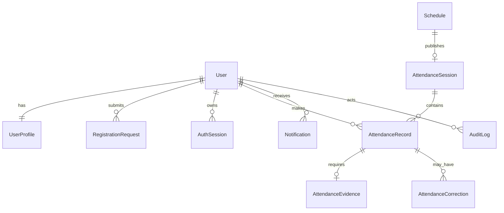

# Database

MySQL 8.4, UTC, Prisma schema di `prisma/schema.prisma`. Entitas: User, UserProfile, RegistrationRequest, Schedule, AttendanceSession, AttendanceRecord, AttendanceEvidence, AttendanceCorrection, Notification, AuditLog, AuthSession, PasswordResetToken, SystemSetting.

Constraint penting: email/NPM/profile user unique; record unique `(userId, sessionId, type)` dan `(userId, idempotencyKey)`; sesi unique schedule/date; evidence one-to-one; pending registration memakai `pendingKey` nullable dan composite unique. Foto tidak disimpan dalam database.
